# Portfolio Builder — Architecture, UI & Control Flow

Companion to [`PLAN.md`](../PLAN.md). This document describes **how the pieces fit
together**, **what each screen looks like**, and **how control moves through the app**
for every major user action.

---

## 1. Guiding principles

1. **Everything is an operation.** Every change — typing in a form, inline text edit,
   dragging a section, a theme slider, saving code, an AI prompt — becomes a typed
   `Operation` applied by one reducer. One code path means one undo stack, one
   autosave, one version history, and AI edits that are just "operations proposed by a
   model".
2. **Data in, files out.** `PortfolioContent` + `SiteSpec` + `CustomCode` are the source
   of truth. HTML/CSS/JS files are always *derived* by the renderer, never stored as the
   primary state.
3. **The browser does the instant work, the server does the trusted work.** Rendering,
   preview, theme/layout edits and cheap checks run in the browser. AI calls, API keys,
   imports, URL capture, image processing and export run on the server.
4. **AI output is validated before it touches state.** Models return schema-checked
   JSON; nothing a model says is executed directly.

---

## 2. System architecture

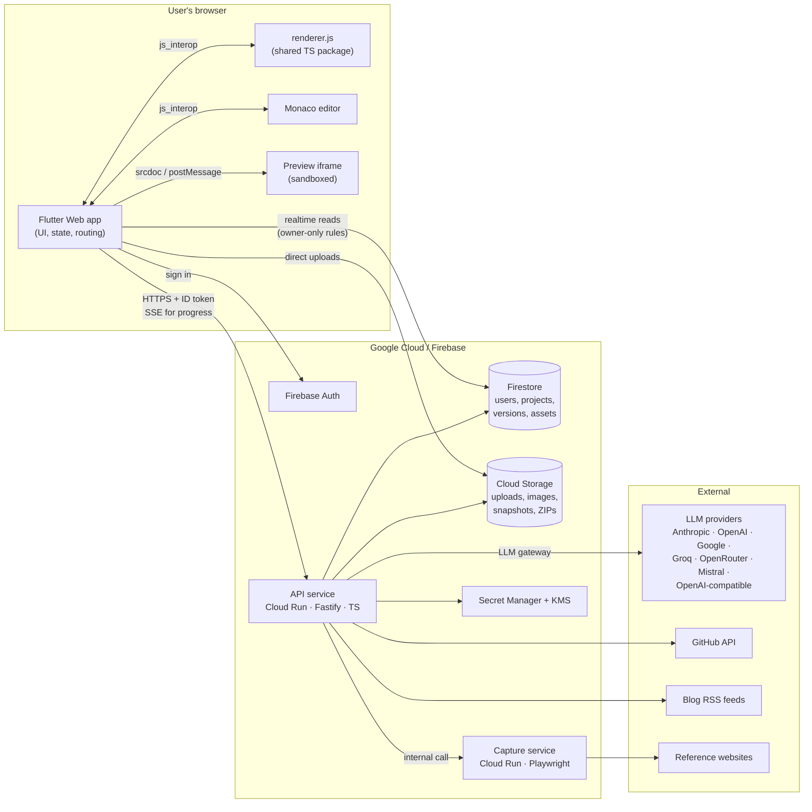

### Responsibilities

| Component | Owns | Never does |
|---|---|---|
| **Flutter app** | UI, routing, editor state, operations reducer, undo/redo, autosave scheduling, preview orchestration | Hold API keys, call LLMs, fetch third-party sites |
| **renderer.js** | `render(content, spec, custom) → files`, section templates, theme → CSS, cheap checks (contrast, missing alt, empty sections) | Network calls, side effects |
| **Monaco** | Code editing, syntax highlighting, diff view | Saving — it only reports changes to Dart |
| **Preview iframe** | Displaying the rendered site, click-to-select, intercepting form submits | Accessing the app (no `allow-same-origin`) |
| **API service** | Auth check, quotas, AI tasks, imports, asset processing, versions, export, key management | Long blocking work without streaming progress |
| **Capture service** | Screenshotting reference sites, computed-style extraction, full quality checks (axe, responsive) | Reaching private networks (SSRF guard) |
| **Firestore** | Metadata, content, spec, custom code, version index | Large blobs (those go to Storage) |
| **Cloud Storage** | Resumes, images, version snapshots, screenshots, ZIPs | Public access (signed URLs only) |

---

## 3. Flutter app architecture

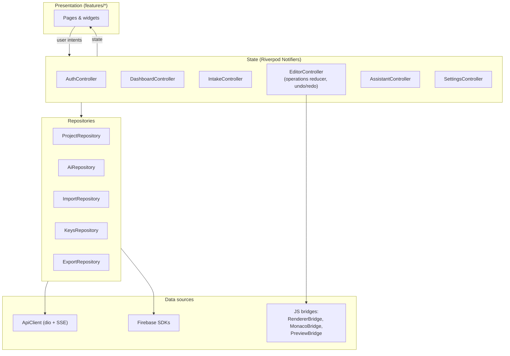

- **Unidirectional flow**: widgets send *intents* → controllers update immutable state →
  widgets rebuild. Widgets never call repositories directly.
- **Routing (go_router)** with an auth guard:

| Route | Screen |
|---|---|
| `/signin`, `/verify-email` | Sign-in, email verification |
| `/` | Dashboard |
| `/new/:step` | Intake wizard (`type`, `import`, `content`, `goals`, `inspiration`, `review`) |
| `/p/:id/generate` | Generation progress → design directions |
| `/p/:id/edit?mode=visual\|code` | Editor workspace |
| `/settings/ai`, `/settings/account` | Settings |

### Editor state (single source of truth while editing)

```ts
EditorState {
  projectId, baseVersionId
  content: PortfolioContent
  spec: SiteSpec
  custom: CustomCode
  rendered: SiteFiles          // derived — never edited directly
  past: Operation[][]          // undo stack (grouped)
  future: Operation[][]        // redo stack
  dirty: boolean, saving: boolean, lastSavedAt
  selection?: { sectionId, cssPath }
  mode: 'visual' | 'code'
  openFile?: string
  pendingProposal?: Proposal   // AI change awaiting accept/reject
  checks: CheckResult[]        // instant checks from renderer
}
```

### Backend module layout

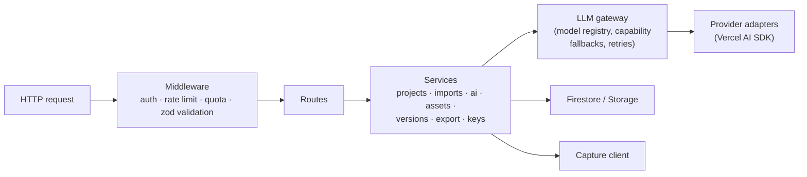

---

## 4. UI

### 4.1 Screen map

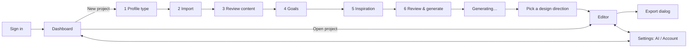

### 4.2 Wireframes

**Dashboard**
```
┌──────────────────────────────────────────────────────────────────────────┐
│ ◆ Portfolio Builder                          AI: Starter 2/3  ⚙  (avatar) │
├──────────────────────────────────────────────────────────────────────────┤
│ Your portfolios                                         [ + New portfolio ]│
│ ┌────────────┐ ┌────────────┐ ┌────────────┐                              │
│ │ thumbnail  │ │ thumbnail  │ │  + Create  │      3 of 5 projects used     │
│ │ Jane — Dev │ │ Jane — UX  │ │            │                              │
│ │ Edited 2h  │ │ Draft      │ │            │                              │
│ │ ⋯ rename/duplicate/delete │              │                              │
│ └────────────┘ └────────────┘ └────────────┘                              │
└──────────────────────────────────────────────────────────────────────────┘
```

**Intake wizard — step 2, Import**
```
┌──────────────────────────────────────────────────────────────────────────┐
│ ← Back   New portfolio   ● Type ● Import ○ Content ○ Goals ○ Inspo ○ Review│
├──────────────────────────────────────────────────────────────────────────┤
│  Bring in what you already have (all optional)                            │
│  ┌──────────────────────────────┐  ┌──────────────────────────────┐       │
│  │  ⬆ Drop resume (PDF/DOCX)     │  │  GitHub username              │       │
│  │  or browse · max 10 MB        │  │  [ janedoe        ] [Import]  │       │
│  │  ✓ resume.pdf — 14 items found│  │  ✓ 6 repos found              │       │
│  └──────────────────────────────┘  └──────────────────────────────┘       │
│  ┌──────────────────────────────┐  ┌──────────────────────────────┐       │
│  │  LinkedIn: how to export PDF │  │  Blog RSS URL                 │       │
│  └──────────────────────────────┘  └──────────────────────────────┘       │
│  ⓘ Your resume is sent to: Starter model (provider X). Change in Settings │
│                                              [ Skip ]  [ Continue → ]     │
└──────────────────────────────────────────────────────────────────────────┘
```

**Intake wizard — step 5, Inspiration**
```
┌──────────────────────────────────────────────────────────────────────────┐
│  Show us sites you like (up to 3)                                         │
│  [ https://example-portfolio.com                     ] [Analyze]          │
│  ┌──────────────────────────────────────────────────────────────────┐    │
│  │ [screenshot]  Palette ■■■■■  Fonts: Serif display / Sans body     │    │
│  │               Layout: split hero · card grid · generous spacing   │    │
│  │   Borrow:  [✓ Colours] [✓ Fonts] [ Layout] [✓ Mood]                │    │
│  └──────────────────────────────────────────────────────────────────┘    │
│  …or pick a style:  (Minimal) (Bold) (Editorial) (Playful) (Technical)    │
└──────────────────────────────────────────────────────────────────────────┘
```

**Pick a design direction**
```
┌──────────────────────────────────────────────────────────────────────────┐
│  3 directions for Jane — same content, different design                   │
│  ┌──────────────┐  ┌──────────────┐  ┌──────────────┐                    │
│  │  live mini   │  │  live mini   │  │  live mini   │                    │
│  │  preview     │  │  preview     │  │  preview     │                    │
│  │ "Calm grid"  │  │ "Bold type"  │  │ "Warm split" │                    │
│  │ [Use this]   │  │ [Use this]   │  │ [Use this]   │                    │
│  └──────────────┘  └──────────────┘  └──────────────┘                    │
│                         [ ↻ Generate 3 more ]                             │
└──────────────────────────────────────────────────────────────────────────┘
```

**Editor — visual mode**
```
┌──────────────────────────────────────────────────────────────────────────┐
│ ← Jane — Dev  [Visual|Code]  ↶ ↷  Saved ✓   Score 86 ▾  🕘  [Export ZIP]  │
├────────────────┬───────────────────────────────────────────┬─────────────┤
│ SECTIONS  + Add │  [Desktop|Tablet|Mobile]   ⌖ Select mode  │ ASSISTANT    │
│ ≡ Hero    split │ ┌───────────────────────────────────────┐ │ "Make the    │
│ ≡ About         │ │                                       │ │  hero darker"│
│ ≡ Projects grid │ │      live preview (iframe)            │ │ ─ Proposed: ─│
│ ≡ Experience    │ │   click text to edit inline           │ │ • theme: bg… │
│ ≡ Skills   tags │ │   click section to select             │ │ • hero: var… │
│ ≡ Contact  form │ │                                       │ │ [Accept]     │
│────────────────│ └───────────────────────────────────────┘ │ [Reject]     │
│ THEME | CONTENT│                                           │              │
│ Colours ■■■■   │  Selected: Projects — variant [grid ▾]     │ [ Ask… ]  ➤  │
│ Fonts  [pair ▾]│  options: columns 3 · show tags ✓          │              │
│ Radius ──●──   │                                           │              │
└────────────────┴───────────────────────────────────────────┴─────────────┘
```

**Editor — code mode**
```
┌──────────────────────────────────────────────────────────────────────────┐
│ ← Jane — Dev  [Visual|Code]  ↶ ↷  ● Unsaved   [Save]       [Export ZIP]   │
├──────────────┬───────────────────────────────┬───────────────────────────┤
│ FILES        │ index.html                     │ preview                    │
│ index.html   │ <!-- pb:section id="hero" --> │                           │
│ assets/css/  │ <section class="hero">…       │                           │
│  theme.css 🔒│ ⚠ Editing this section makes  │                           │
│  custom.css  │   it a custom section [Undo]  │                           │
│ assets/js/   │                               │                           │
│  custom.js   │                               │                           │
└──────────────┴───────────────────────────────┴───────────────────────────┘
 🔒 = generated from theme panel (edit there, or edit custom.css)
```

**Settings → AI**
```
┌──────────────────────────────────────────────────────────────────────────┐
│ AI access   (•) Starter — 2 of 3 generations, 31 of 50 edits left (Oct)   │
│             ( ) My own keys                                               │
│ Keys        Anthropic  ••••7Hk2  [Test] [Replace] [Delete]                │
│             [+ Add key]   Free key guides: Gemini · Groq · OpenRouter     │
│ Model       Simple: one model [ claude-… ▾ ]  ✓Recommended 📄 👁 { }       │
│             ( ) Advanced: Smart [ … ▾ ]  Fast [ … ▾ ]                     │
│ ⓘ This model can't read images — inspiration will use page styles only.  │
└──────────────────────────────────────────────────────────────────────────┘
```

---

## 5. Control flows

### 5.1 Sign-in and route guard
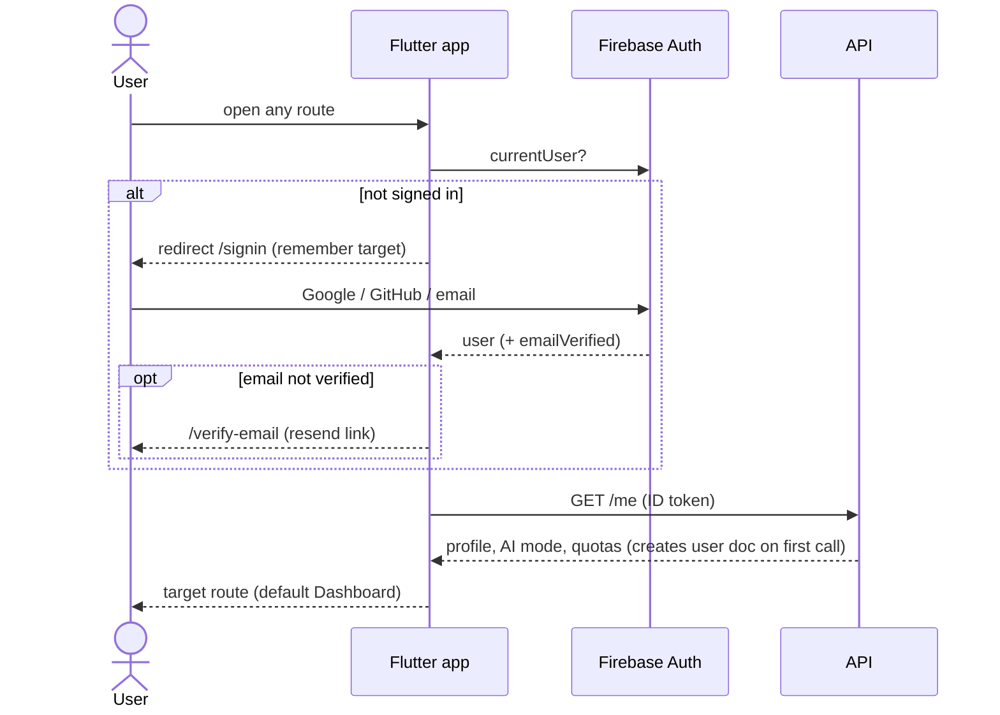

### 5.2 Resume import
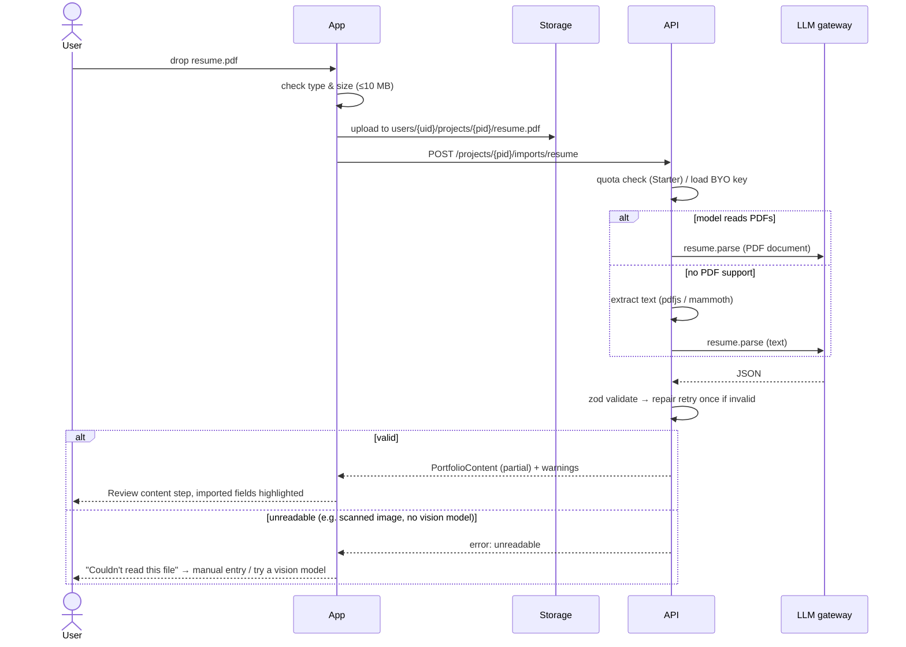

### 5.3 Inspiration analysis
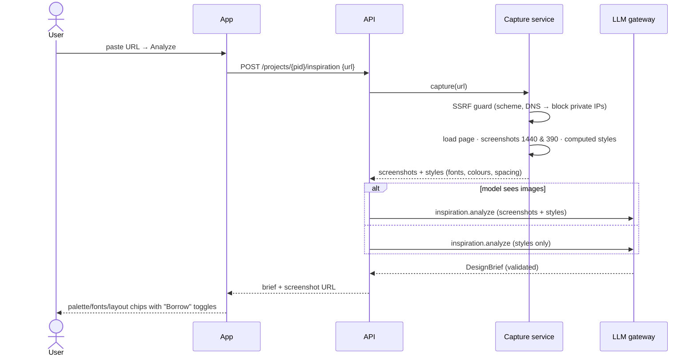

### 5.4 Generate → pick a direction
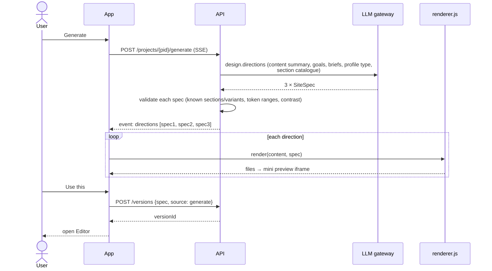
Content is never sent back by the model — only specs — so facts can't change during design.

### 5.5 Visual editing loop (no AI)
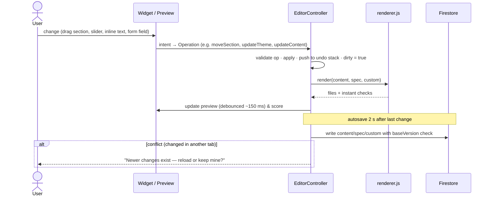
Inline text editing: the preview script makes text elements with `data-pb-path="projects[2].title"`
editable; on blur it posts `{path, value}` to the app, which becomes an `updateContent` operation.

### 5.6 Code editing
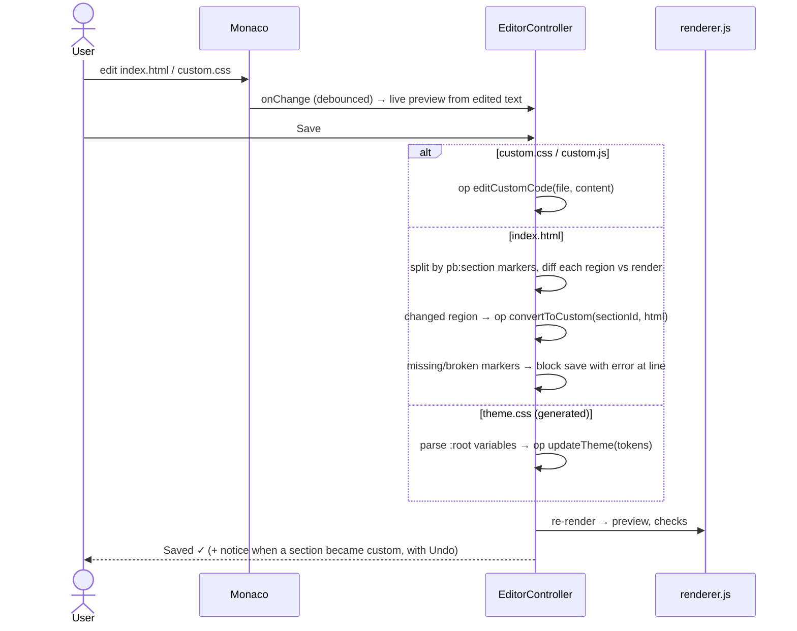

### 5.7 AI assistant edit
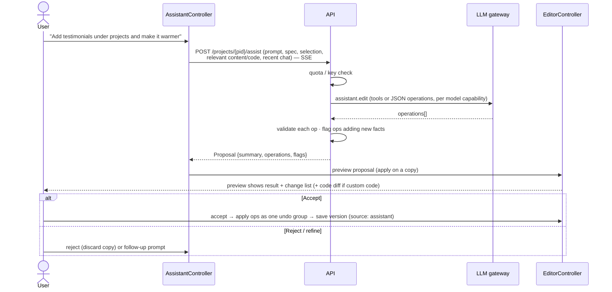

### 5.8 AI request routing (every AI call)
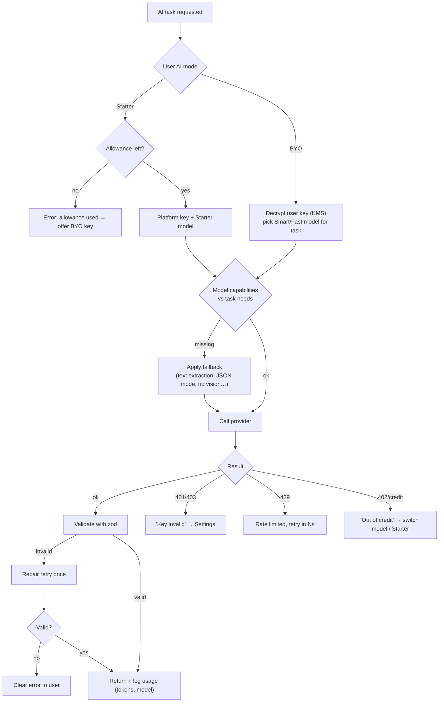

### 5.9 Add key & choose model
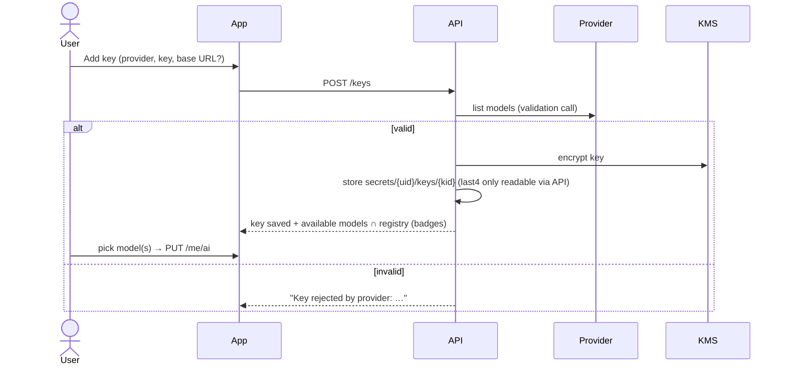

### 5.10 Export ZIP
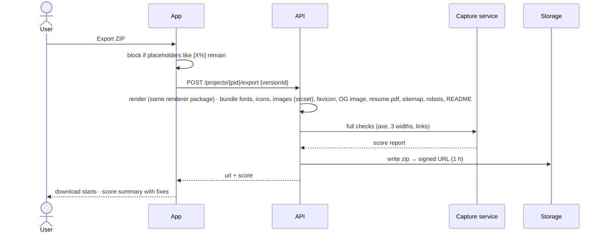

### 5.11 Project lifecycle
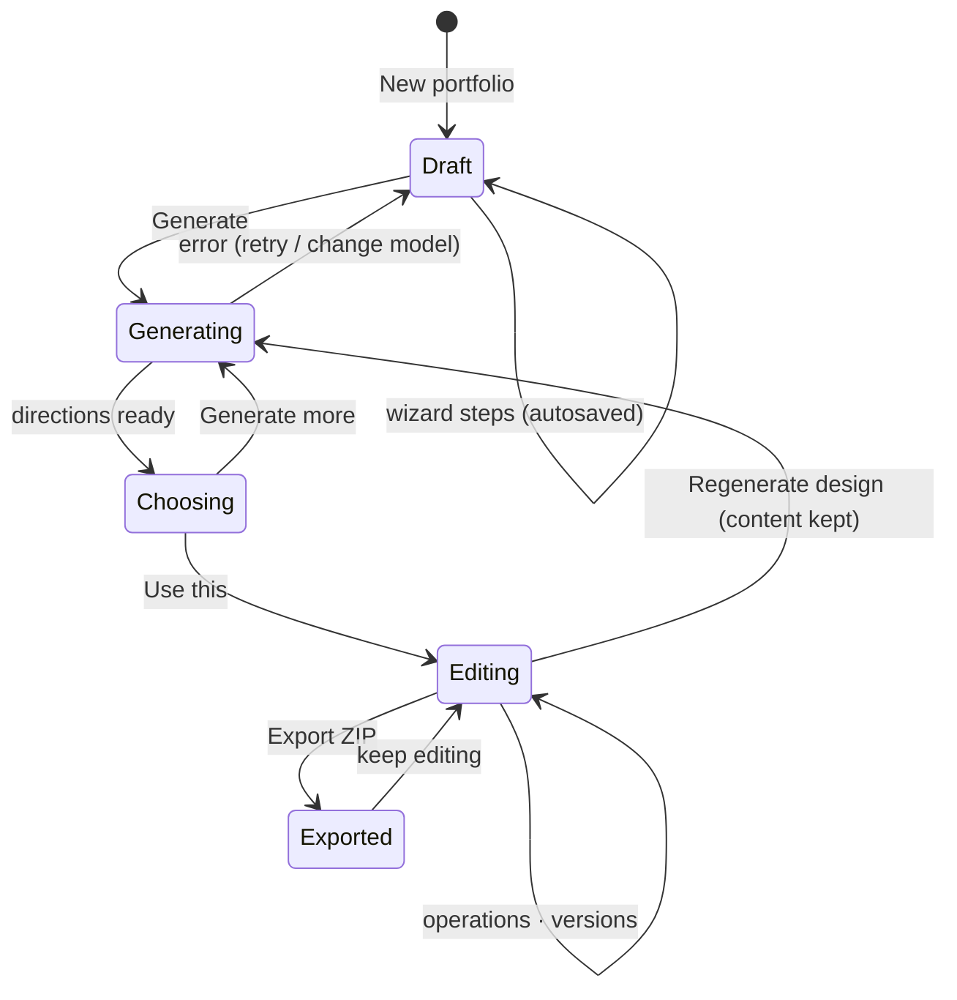

---

## 6. Key interfaces

```ts
// packages/schema
type Operation =
  | { op: 'updateContent'; path: string; value: unknown }
  | { op: 'addItem' | 'removeItem'; path: string; item?: unknown; id?: string }
  | { op: 'updateTheme'; tokens: Partial<ThemeTokens> }
  | { op: 'addSection'; type: SectionType; variant: string; index: number }
  | { op: 'removeSection' | 'toggleSection'; id: string }
  | { op: 'moveSection'; id: string; index: number }
  | { op: 'setVariant'; id: string; variant: string }
  | { op: 'setSectionOptions'; id: string; options: Record<string, unknown> }
  | { op: 'convertToCustom'; id: string; html: string; css?: string; js?: string }
  | { op: 'revertToManaged'; id: string }
  | { op: 'editCustomCode'; file: 'custom.css' | 'custom.js'; content: string }
  | { op: 'setSeo' | 'setContactForm'; value: unknown };

function apply(state: SiteState, op: Operation): SiteState;   // pure, shared
function render(state: SiteState): { files: SiteFiles; checks: CheckResult[] };
```

The same `apply` and `render` run in the browser (instant editing) and on the server
(validating AI proposals and exporting), so what you see is exactly what you download.

### API surface (v1)
| Method & path | Purpose |
|---|---|
| `GET /me` · `PUT /me/ai` | Profile, AI mode, quotas · change AI settings |
| `POST /keys` · `DELETE /keys/:id` · `POST /keys/:id/test` | Manage BYO keys |
| `GET /models?keyId=` | Available models with capability badges |
| `POST /projects` · `PATCH/DELETE /projects/:id` · `POST /projects/:id/duplicate` | Projects |
| `POST /projects/:id/imports/{resume,github,rss}` | Imports |
| `POST /projects/:id/inspiration` | Analyze reference URL / screenshot |
| `POST /projects/:id/generate` (SSE) | Design directions |
| `POST /projects/:id/assist` (SSE) | Assistant proposal |
| `POST /projects/:id/content-assist` | Rewrite / tagline / case study / alt text |
| `GET/POST /projects/:id/versions` · `POST …/versions/:vid/restore` | Versions |
| `POST /projects/:id/assets` | Image processing |
| `POST /projects/:id/export` | ZIP + full score |
| `GET /me/export` · `DELETE /me` | Data export · account deletion |
