# Portfolio Builder — Architecture, UI & Control Flow

Companion to [`PLAN.md`](../PLAN.md). This document describes **how the pieces fit
together**, **what each screen looks like**, and **how control moves through the app**
for every major user action.

---

## 1. Guiding principles

1. **Thin server, heavy browser.** All processing runs on the user's computer: AI calls
   with their own key, resume parsing, image processing, rendering, quality checks and
   ZIP export. The server only does what a browser can't do safely: sign-in, storing
   data behind security rules, relaying Starter AI requests (our key must stay secret),
   and cleaning up deleted accounts.
2. **Everything is an operation.** Every change — typing in a form, inline text edit,
   dragging a section, a theme slider, saving code, an AI prompt — becomes a typed
   `Operation` applied by one reducer. One undo stack, one autosave, one version
   history; AI edits are just "operations proposed by a model".
3. **Data in, files out.** `PortfolioContent` + `SiteSpec` + `CustomCode` are the source
   of truth. HTML/CSS/JS files are always *derived* by the renderer.
4. **AI output is validated before it touches state.** Models return schema-checked
   JSON; nothing a model says is executed directly.

---

## 2. System architecture

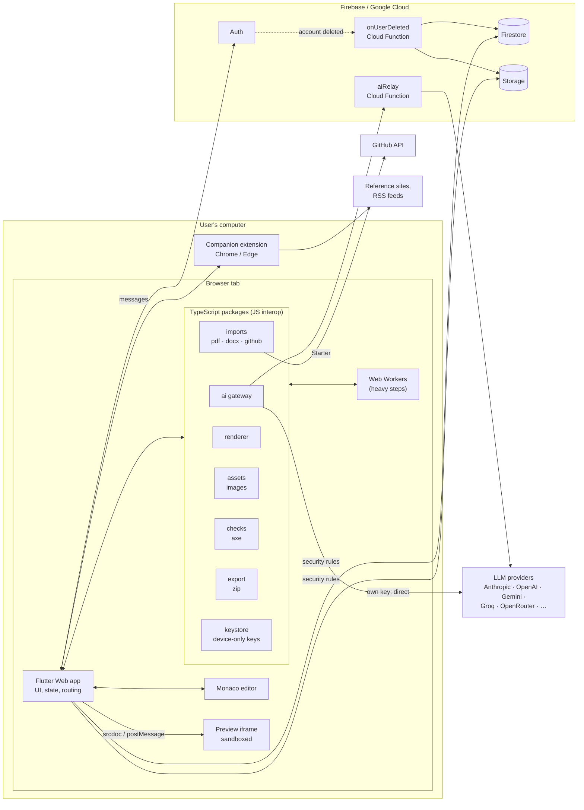

### What runs where

| Where | Piece | Job |
|---|---|---|
| **Browser** | Flutter app | UI, routing, editor state, operations reducer, undo/redo, autosave |
| | renderer | `render(content, spec, custom) → files`, `apply(state, op)` |
| | ai gateway | Prompts, model registry, capability fallbacks, validation + repair retry, direct or relay transport |
| | imports | PDF/DOCX text extraction (pdf.js, mammoth), GitHub API, feed parsing |
| | assets | Resize, WebP encode, EXIF strip, crop, favicon, OG image |
| | checks | Instant checks on every render; axe-core + 3 widths before export |
| | export | Build the ZIP and download it |
| | keystore | Encrypt/store own API keys in IndexedDB (never uploaded) |
| | Web Workers | Run image, PDF, ZIP and thumbnail rendering off the UI thread |
| **Extension** | capture | Open reference site, screenshots at 2 widths, computed styles |
| | fetch | RSS feeds, external link checks |
| **Server** | Firebase Auth | Sign-in |
| | Firestore / Storage | Data, protected by owner-only security rules |
| | `aiRelay` | Starter only: verify token → check/count allowance → add our key → stream through |
| | `onUserDeleted` | Delete a deleted user's data |
| | Configuration only | Backups, file expiry, budget alerts |

Why each server piece can't move to the browser:
- **Auth / database / storage** — data has to live somewhere shared and be protected
  from other users; the browser can't enforce that on its own.
- **aiRelay** — the Starter allowance uses *our* API key. Anything sent to a browser can
  be read, so the key must stay on a server. The relay only forwards and waits.
- **onUserDeleted** — the account may be gone before the browser finishes cleaning up,
  so cleanup must be guaranteed server-side.

---

## 3. Flutter app architecture

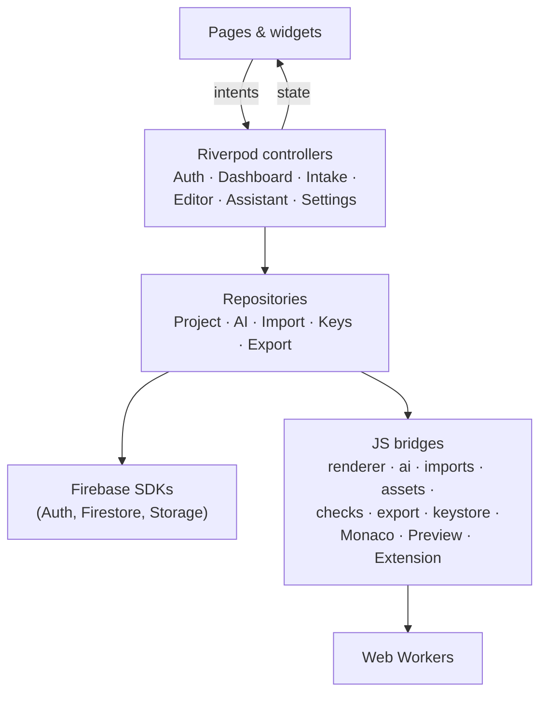

- **Unidirectional flow**: widgets send intents → controllers update immutable state →
  widgets rebuild. Widgets never call repositories directly.
- **Dart ↔ TypeScript**: packages are bundled with esbuild into `web/js/`, exposed on a
  single `window.pb` object, and called from Dart with `dart:js_interop`. Long tasks
  return Promises or streams; heavy ones run in Web Workers.

| Route | Screen |
|---|---|
| `/signin`, `/verify-email` | Sign-in, email verification |
| `/` | Dashboard |
| `/new/:step` | Intake wizard (`type`, `import`, `content`, `goals`, `inspiration`, `review`) |
| `/p/:id/generate` | Generation progress → design directions |
| `/p/:id/edit?mode=visual\|code` | Editor workspace |
| `/settings/ai`, `/settings/account` | Settings |

### Editor state

```ts
EditorState {
  projectId, baseVersionId
  content: PortfolioContent
  spec: SiteSpec
  custom: CustomCode
  rendered: SiteFiles          // derived — never edited directly
  past: Operation[][]          // undo stack (grouped)
  future: Operation[][]        // redo stack
  dirty, saving, lastSavedAt
  selection?: { sectionId, cssPath }
  mode: 'visual' | 'code'
  openFile?: string
  pendingProposal?: Proposal   // AI change awaiting accept/reject (in memory only)
  checks: CheckResult[]
}
```

### Server code (all of it)

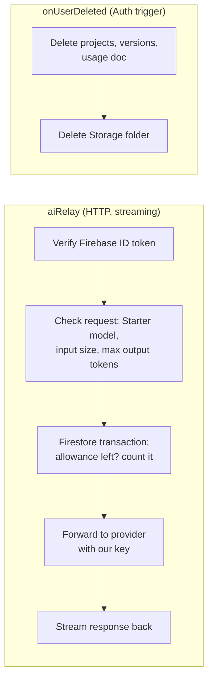

---

## 4. Companion extension

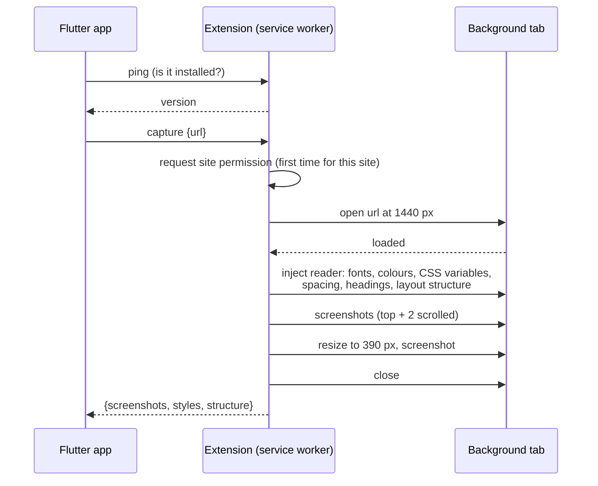

- **Manifest V3**, TypeScript. Permissions: `activeTab`, `scripting`, `storage`; site
  access via optional host permissions requested per site; `externally_connectable`
  limited to the app's domain.
- **Messages**: `ping`, `capture {url}`, `fetchFeed {url}`, `checkLinks {urls}`,
  `getPendingCaptures` (captures sent from the toolbar button while browsing).
- **Fallback**: no extension → *Install extension* prompt + screenshot upload.

---

## 5. UI

### 5.1 Screen map

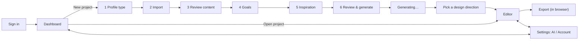

### 5.2 Wireframes

**Dashboard**
```
┌──────────────────────────────────────────────────────────────────────────┐
│ ◆ Portfolio Builder                          AI: Starter 2/3  ⚙  (avatar) │
├──────────────────────────────────────────────────────────────────────────┤
│ Your portfolios                                         [ + New portfolio ]│
│ ┌────────────┐ ┌────────────┐ ┌────────────┐                              │
│ │ thumbnail  │ │ thumbnail  │ │  + Create  │      2 of 5 projects used     │
│ │ Jane — Dev │ │ Jane — Free│ │            │                              │
│ │ Edited 2h  │ │ Draft      │ │            │                              │
│ │ ⋯ rename/duplicate/delete │              │                              │
│ └────────────┘ └────────────┘ └────────────┘                              │
└──────────────────────────────────────────────────────────────────────────┘
```

**Intake wizard — step 2, Import**
```
┌──────────────────────────────────────────────────────────────────────────┐
│ ← Back   New portfolio   ● Type ● Import ○ Content ○ Goals ○ Inspo ○ Review│
├──────────────────────────────────────────────────────────────────────────┤
│  Bring in what you already have (all optional)                            │
│  ┌──────────────────────────────┐  ┌──────────────────────────────┐       │
│  │  ⬆ Drop resume (PDF/DOCX)     │  │  GitHub username              │       │
│  │  read on your computer        │  │  [ janedoe        ] [Import]  │       │
│  │  ✓ resume.pdf — 14 items found│  │  ✓ 6 repos found              │       │
│  └──────────────────────────────┘  └──────────────────────────────┘       │
│  ┌──────────────────────────────┐  ┌──────────────────────────────┐       │
│  │  LinkedIn: how to export PDF │  │  Blog feed URL (via extension)│       │
│  └──────────────────────────────┘  └──────────────────────────────┘       │
│  ⓘ Resume text is sent to: your Anthropic key (direct). Change in Settings│
│                                              [ Skip ]  [ Continue → ]     │
└──────────────────────────────────────────────────────────────────────────┘
```

**Intake wizard — step 5, Inspiration**
```
┌──────────────────────────────────────────────────────────────────────────┐
│  Show us sites you like (up to 3)              Extension: ✓ installed     │
│  [ https://example-portfolio.dev                     ] [Analyze]          │
│  ┌──────────────────────────────────────────────────────────────────┐    │
│  │ [screenshot]  Palette ■■■■■  Fonts: Serif display / Sans body     │    │
│  │               Layout: split hero · card grid · generous spacing   │    │
│  │   Borrow:  [✓ Colours] [✓ Fonts] [ Layout] [✓ Mood]                │    │
│  └──────────────────────────────────────────────────────────────────┘    │
│  No extension? [Install] or [Upload screenshots]                          │
│  …or pick a style:  (Minimal) (Bold) (Editorial) (Playful) (Technical)    │
└──────────────────────────────────────────────────────────────────────────┘
```

**Pick a design direction**
```
┌──────────────────────────────────────────────────────────────────────────┐
│  3 directions for Jane — same content, different design                   │
│  ┌──────────────┐  ┌──────────────┐  ┌──────────────┐                    │
│  │  live mini   │  │  live mini   │  │  live mini   │                    │
│  │  preview     │  │  preview     │  │  preview     │                    │
│  │ "Calm grid"  │  │ "Bold type"  │  │ "Warm split" │                    │
│  │ [Use this]   │  │ [Use this]   │  │ [Use this]   │                    │
│  └──────────────┘  └──────────────┘  └──────────────┘                    │
│                         [ ↻ Generate 3 more ]                             │
└──────────────────────────────────────────────────────────────────────────┘
```

**Editor — visual mode**
```
┌──────────────────────────────────────────────────────────────────────────┐
│ ← Jane — Dev  [Visual|Code]  ↶ ↷  Saved ✓   Score 86 ▾  🕘  [Export ZIP]  │
├────────────────┬───────────────────────────────────────────┬─────────────┤
│ SECTIONS  + Add │  [Desktop|Tablet|Mobile]   ⌖ Select mode  │ ASSISTANT    │
│ ≡ Hero    split │ ┌───────────────────────────────────────┐ │ "Make the    │
│ ≡ About         │ │                                       │ │  hero darker"│
│ ≡ Projects grid │ │      live preview (iframe)            │ │ ─ Proposed: ─│
│ ≡ Experience    │ │   click text to edit inline           │ │ • theme: bg… │
│ ≡ Skills   tags │ │   click section to select             │ │ • hero: var… │
│ ≡ Contact  form │ │                                       │ │ [Accept]     │
│────────────────│ └───────────────────────────────────────┘ │ [Reject]     │
│ THEME | CONTENT│                                           │              │
│ Colours ■■■■   │  Selected: Projects — variant [grid ▾]     │ [ Ask… ]  ➤  │
│ Fonts  [pair ▾]│  options: columns 3 · show tags ✓          │              │
│ Radius ──●──   │                                           │              │
└────────────────┴───────────────────────────────────────────┴─────────────┘
```

**Editor — code mode**
```
┌──────────────────────────────────────────────────────────────────────────┐
│ ← Jane — Dev  [Visual|Code]  ↶ ↷  ● Unsaved   [Save]       [Export ZIP]   │
├──────────────┬───────────────────────────────┬───────────────────────────┤
│ FILES        │ index.html                     │ preview                    │
│ index.html   │ <!-- pb:section id="hero" --> │                           │
│ assets/css/  │ <section class="hero">…       │                           │
│  theme.css 🔒│ ⚠ Editing this section makes  │                           │
│  custom.css  │   it a custom section [Undo]  │                           │
│ assets/js/   │                               │                           │
│  custom.js   │                               │                           │
└──────────────┴───────────────────────────────┴───────────────────────────┘
 🔒 = generated from theme panel (edit there, or edit custom.css)
```

**Settings → AI**
```
┌──────────────────────────────────────────────────────────────────────────┐
│ AI access   ( ) Starter — 2 of 3 generations, 31 of 50 edits left (Oct)   │
│             (•) My own keys — stored on this device only, never uploaded  │
│ Keys        Anthropic  ••••7Hk2  [Test] [Replace] [Delete]                │
│             [+ Add key]  [Sign in with OpenRouter]                        │
│             Free key guides: Gemini · Groq · OpenRouter                   │
│ Model       Simple: one model [ claude-… ▾ ]  ✓Recommended 📄 👁 { }       │
│             ( ) Advanced: Smart [ … ▾ ]  Fast [ … ▾ ]                     │
│ ⓘ This model can't read images — inspiration will use page styles only.  │
└──────────────────────────────────────────────────────────────────────────┘
```

---

## 6. Control flows

### 6.1 Sign-in and route guard
```mermaid
sequenceDiagram
  actor U as User
  participant App as Flutter app
  participant Auth as Firebase Auth
  participant FS as Firestore
  U->>App: open any route
  App->>Auth: currentUser?
  alt not signed in
    App-->>U: redirect /signin (remember target)
    U->>Auth: Google / GitHub / email
    Auth-->>App: user (+ emailVerified)
    opt email not verified
      App-->>U: /verify-email (resend link)
    end
  end
  App->>FS: read users/{uid} (create on first sign-in; rules: owner only)
  App->>FS: read usage/{uid} (read-only for client)
  App-->>U: target route (default Dashboard)
```

### 6.2 Resume import (all in the browser)
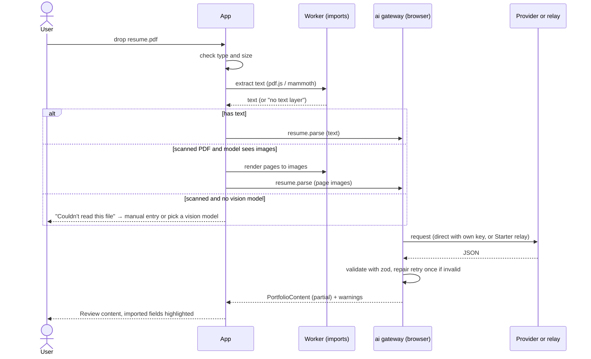

### 6.3 Inspiration via the extension
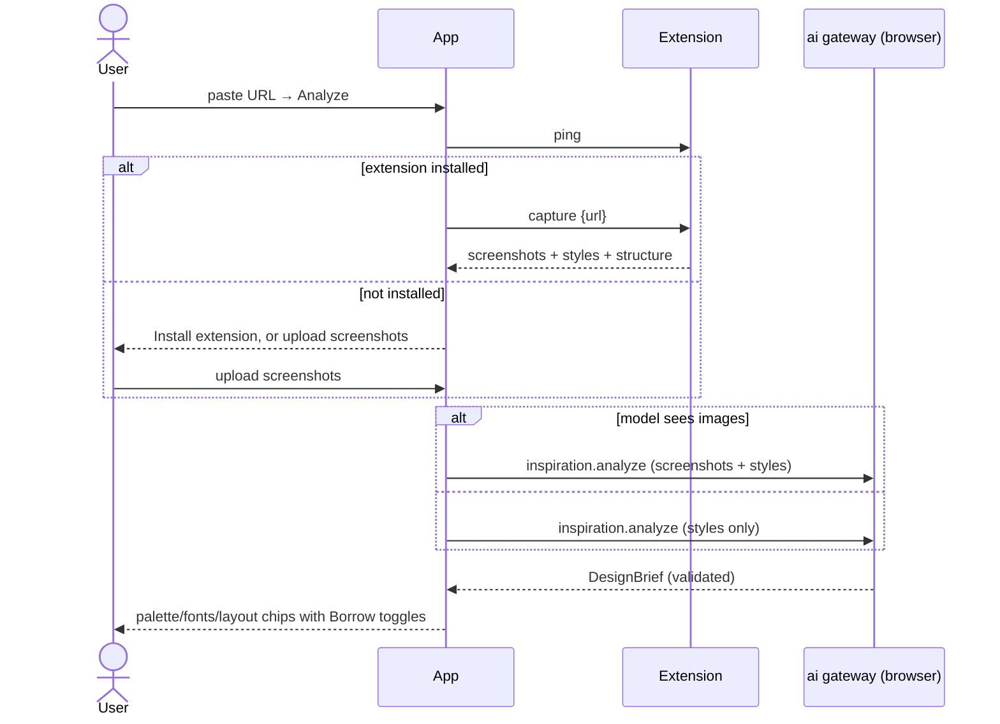

### 6.4 Generate → pick a direction
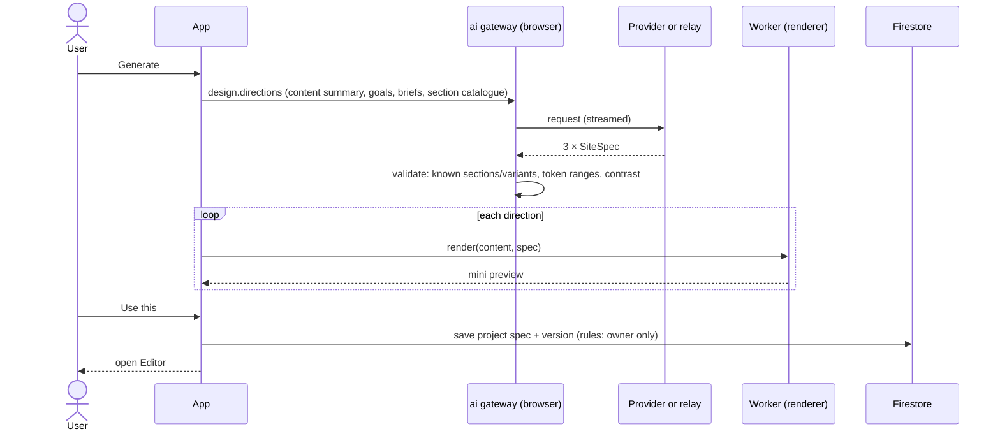
The model returns only design specs, never content, so facts can't change during design.

### 6.5 Visual editing loop (no AI, no server)
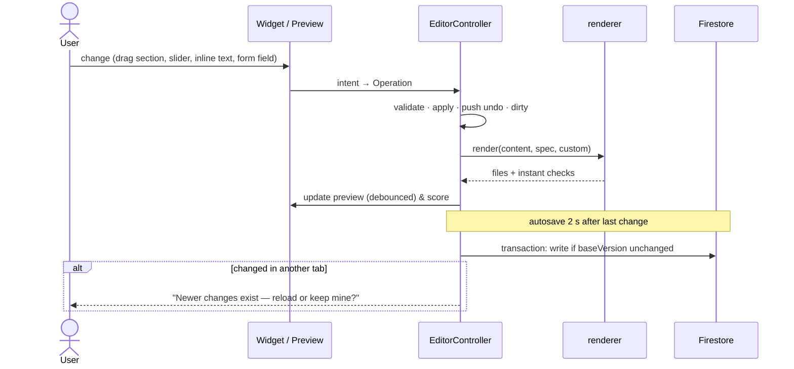

### 6.6 Code editing
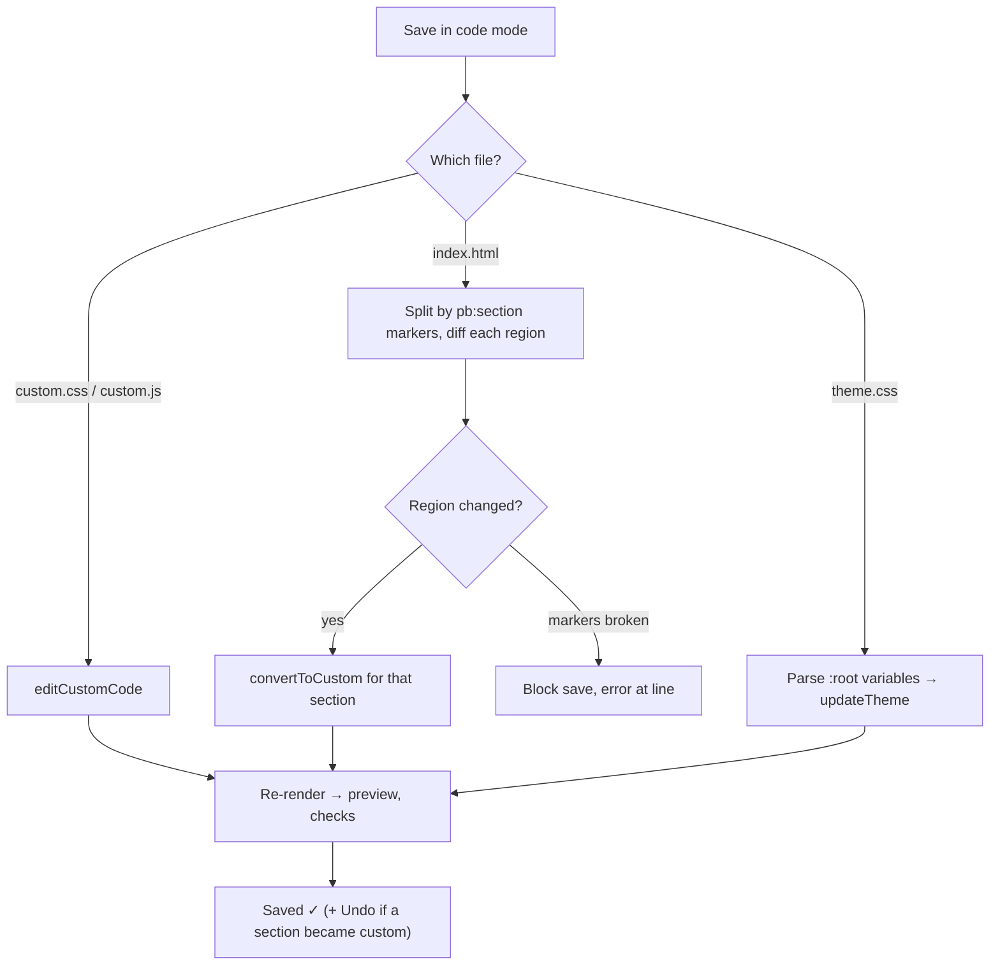

### 6.7 AI assistant edit (proposal kept in memory only)
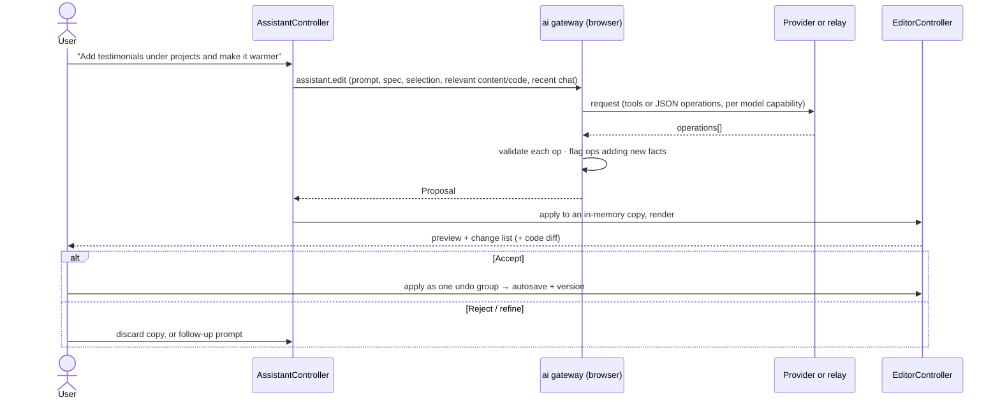

### 6.8 Routing every AI request
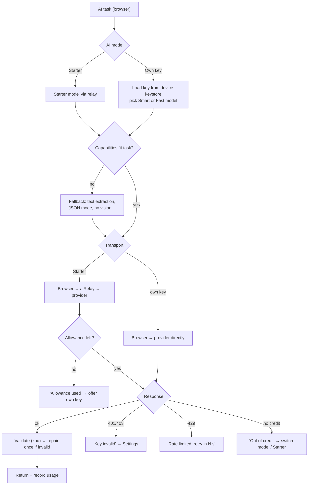

### 6.9 Add a key or sign in with OpenRouter
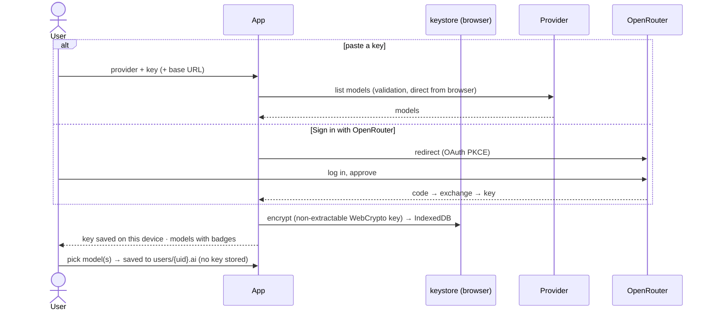

### 6.10 Export ZIP (in the browser)
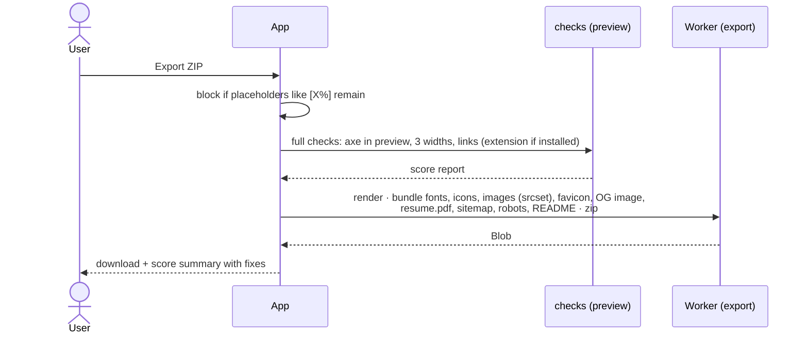

### 6.11 Starter relay (server)
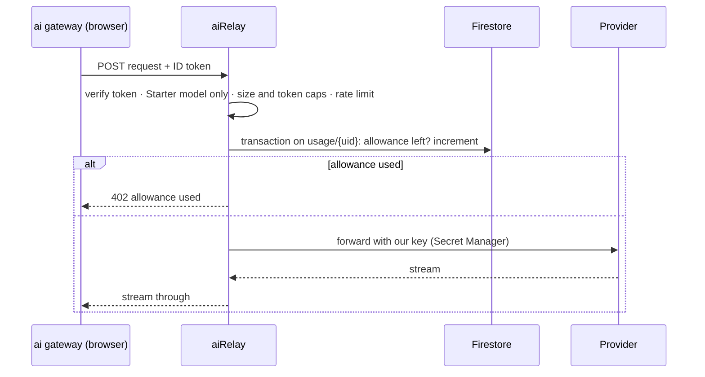

### 6.12 Project lifecycle
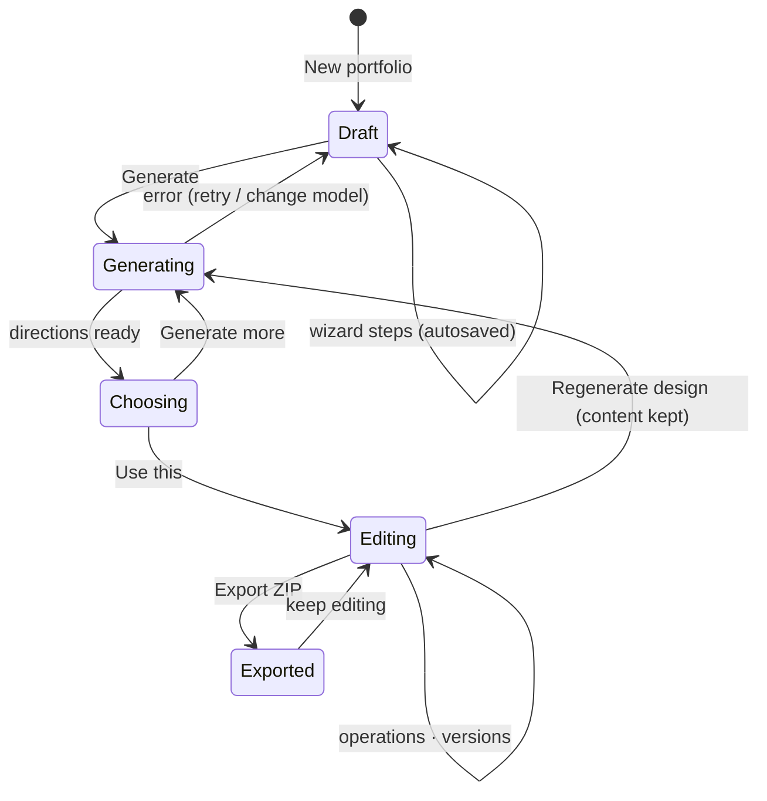

---

## 7. Key interfaces

```ts
// packages/schema
type Operation =
  | { op: 'updateContent'; path: string; value: unknown }
  | { op: 'addItem' | 'removeItem'; path: string; item?: unknown; id?: string }
  | { op: 'updateTheme'; tokens: Partial<ThemeTokens> }
  | { op: 'addSection'; type: SectionType; variant: string; index: number }
  | { op: 'removeSection' | 'toggleSection'; id: string }
  | { op: 'moveSection'; id: string; index: number }
  | { op: 'setVariant'; id: string; variant: string }
  | { op: 'setSectionOptions'; id: string; options: Record<string, unknown> }
  | { op: 'convertToCustom'; id: string; html: string; css?: string; js?: string }
  | { op: 'revertToManaged'; id: string }
  | { op: 'editCustomCode'; file: 'custom.css' | 'custom.js'; content: string }
  | { op: 'setSeo' | 'setContactForm'; value: unknown };

function apply(state: SiteState, op: Operation): SiteState;   // pure
function render(state: SiteState): { files: SiteFiles; checks: CheckResult[] };
```

### Browser package API (exposed to Dart as `window.pb`)
| Call | Package |
|---|---|
| `render(state)`, `apply(state, op)` | renderer |
| `ai.run(task, input, settings)` → stream of events | ai |
| `imports.resume(file)`, `imports.github(user)`, `imports.feed(xml)` | imports |
| `assets.process(file, opts)`, `assets.favicon(...)`, `assets.ogImage(...)` | assets |
| `checks.full(previewHandle)` | checks |
| `exportZip(state, assets)` → Blob | export |
| `keys.save/list/remove/get(provider)` | keystore |
| `ext.ping()`, `ext.capture(url)`, `ext.fetchFeed(url)`, `ext.checkLinks(urls)` | extension bridge |

### Server surface (complete)
| Endpoint / trigger | Purpose |
|---|---|
| `POST /aiRelay` (streaming) | Starter AI requests only |
| Auth `onDelete` → `onUserDeleted` | Remove the user's data |
| Firestore / Storage security rules | Owner-only access; `usage/{uid}` read-only for clients |
